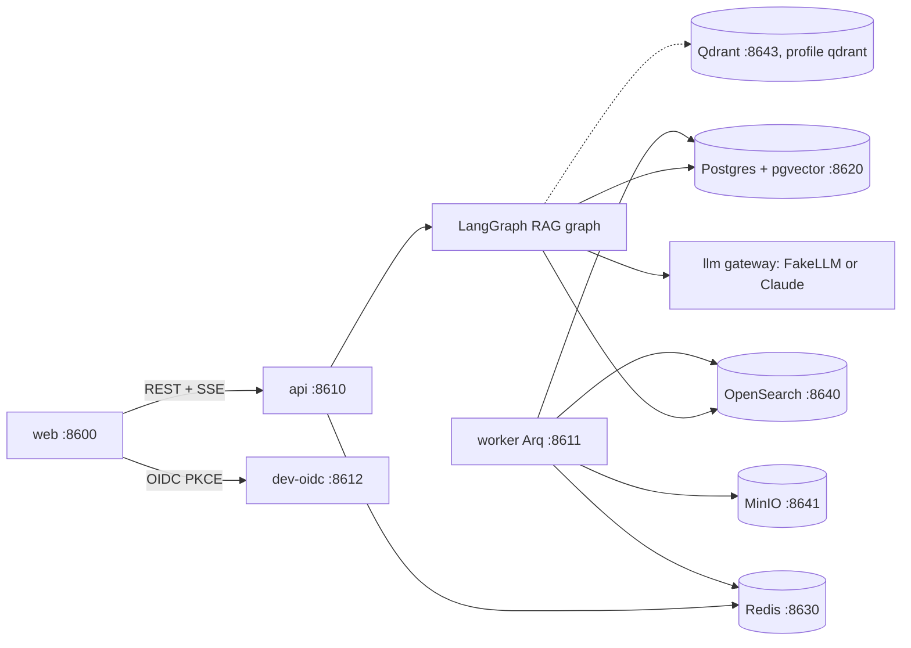
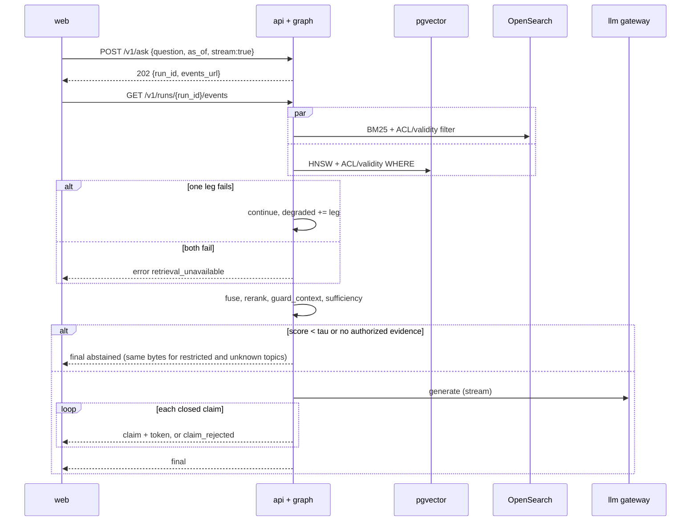
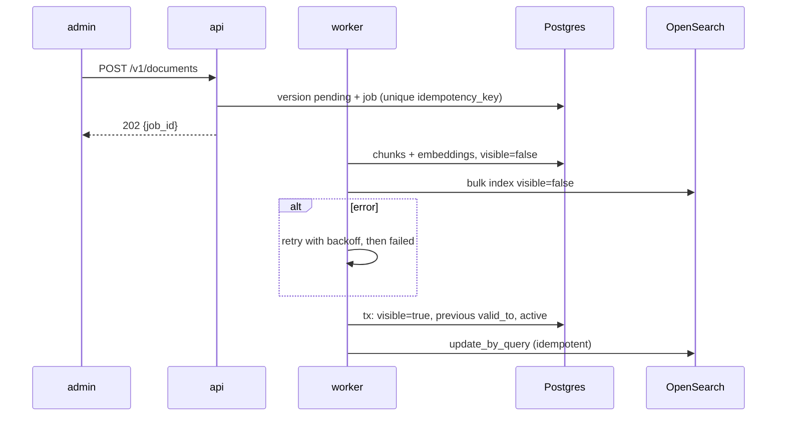

# BUILD: compliance-rag

> **How to run this file.** Put this file alone in an empty folder (local run) or at the root of an empty GitHub repository (Claude Code on the web). Start Claude Code there and send:
> `Read BUILD.md and execute it end to end. Do not stop until every item in the Global Definition of Done is checked.`
> This file is the complete specification. Everything needed to build, test, document and verify the repository is here.

## 0. Operating mode

You are the only engineer on this repository and you work autonomously from the first command to the final verification. Nobody will answer questions while you work.

1. **Do not stop early.** Do not end your turn while any item in §9 Global Definition of Done is unchecked. When you believe you are finished, run §19 Final verification; if anything fails or is unchecked, keep working. The only valid early stop is a hard blocker under §20.

2. **Decide, don't ask.** When something is ambiguous, choose the option that best serves §2 Product brief, record it in `docs/DECISIONS.md` (date, decision, alternatives, reason) and continue. Architectural choices also get an ADR in `docs/adr/`.

3. **Progress lives in the repository.** In M0, create `PROGRESS.md` with a "Needs the maintainer" section at the top, every task from §8 (ID, title, status, evidence), and the Global Definition of Done from §9 as a checklist; check items there, never in this file. Update it after every task and mirror it in your task-tracking tool if you have one. After a context compaction, a restart or a new session, first re-read `BUILD.md` (or `docs/specs/000-build-spec.md`), `PROGRESS.md`, `docs/DECISIONS.md` and `git log --oneline -30`, then resume from the first unchecked task. Never redo finished work.

4. **Small verified increments.** For each task: write the failing test first, implement, run the relevant checks, record evidence in `PROGRESS.md` (the command and a one-line result), and commit with a Conventional Commit message. Never leave the branch red between tasks.

5. **Push often when a remote exists.** After every milestone run `git push -u origin <current-branch>`, retrying network failures up to 4 times with backoff (2, 4, 8, 16 seconds). The container can be reclaimed and unpushed work is lost. Push only the current branch and never force-push.

6. **Honesty over appearance.** Never invent metrics, eval scores, benchmark numbers, screenshots or test results. Every number in the README and docs comes from a command you ran, cited next to it. Never skip, disable, mark as expected-failure or weaken a test or threshold to get green: fix the code, or record the gap in `docs/KNOWN_LIMITATIONS.md`.

7. **Offline first.** Every test, the demo and `make verify` must pass with no API keys and no paid services, using the deterministic fakes and recorded fixtures. Live model calls exist only behind `make eval-live`: it reads keys from the environment, prints the estimated cost first, and stops at `LIVE_EVAL_BUDGET_USD` (default 2). Run it once at the end only if the provider key is set; otherwise the eval report states that live evals were not run.

8. **Safety rails.** Never run `terraform apply` or `terraform destroy`, never deploy to a cloud account, never create, publish or change the visibility of a GitHub repository, never send messages to real recipients (email, SMS, Slack, voice), never commit secrets or real personal data. Synthetic data only. Never change the git identity, and never add Claude attribution to commits or pull requests (§1.1).

9. **Use the harness you build.** From the end of M0, use the subagents, skills, rules and hooks you created in `.claude/` (§7). Run the `reviewer` subagent at the end of every milestone and fix its blockers before moving on. Use parallel subagents only for independent read-heavy work (research, reviews, audits), never for two agents editing the same files. If a subagent or skill you created is not loaded in this session yet, run a general-purpose subagent with that file's instructions, or follow the `SKILL.md` steps by hand.

10. **Use Claude Code's bundled skills when they are available:** `claude-api` before writing any code that calls Claude; `session-start-hook` to build the cloud SessionStart hook; `run` to launch the app and capture screenshots; `code-review`, `security-review` and `simplify` in the final hardening milestone. If one is not available, do the equivalent by hand.

11. **Keep the context lean.** Don't print large files or long logs into the conversation; summarize command output and write long notes to files.

12. **Ownership.** All code is new and MIT licensed. Do not copy code beyond what its license allows, attribute any adapted snippet in a comment, and do not name any real employer, client or product of the maintainer.

## 1. Environment bootstrap

1. **Detect the environment.** `CLAUDE_CODE_REMOTE=true` means Claude Code on the web (apply Appendix A); otherwise local. Record `uname -a` and the versions of python3, uv, node, pnpm, docker and git in `docs/DEVELOPMENT.md`.
2. If there is no `.git`, run `git init -b main`.
3. **Pre-seeded repository note.** The maintainer's initial commit already contains `BUILD.md`, a placeholder `README.md`, `LICENSE`, `.gitignore`, `.claude/settings.json` (with the `attribution` key and a starter permission list) and `.claude/rules/git-commits.md`. If both `.claude` files exist with the required content, §1.1 steps 1–2 are satisfied: verify the content, skip the commit in step 4, run `git log --diff-filter=A --format='%an <%ae> | %cn <%ce>%n%B' -- .claude/rules/git-commits.md` and record its output in `PROGRESS.md`. Step 3 (identity check) always runs.

### 1.1 Commit attribution

Commits and pull requests from this build go out under the maintainer's name only, with no Claude attribution. Do this right after `git init`, before any other commit.

1. Create `.claude/settings.json` with this key. If the file already exists, merge the key without removing anything else:
   ```json
   {
     "attribution": { "commit": "", "pr": "", "sessionUrl": false }
   }
   ```
2. Create `.claude/rules/git-commits.md`, with no `paths:` frontmatter so it always loads, containing this rule:
   ```markdown
   Do not add Co-Authored-By, Claude-Session or "Generated with Claude Code" trailers to commits or pull requests. Do not modify `git config user.*` or the `GIT_AUTHOR_*` / `GIT_COMMITTER_*` variables.
   ```
3. Check that `GIT_AUTHOR_NAME`, `GIT_AUTHOR_EMAIL`, `GIT_COMMITTER_NAME` and `GIT_COMMITTER_EMAIL` are defined. Never define or invent a missing one, and never touch git config.
   - On Claude Code on the web (`CLAUDE_CODE_REMOTE=true`), a missing variable is a hard blocker (§20 d): commit and push nothing, and end by listing the missing variables and saying that they go in the cloud environment's environment variables, followed by a new session.
   - On a local run these variables are usually unset and git uses the local git config. Record the name and email from `git var GIT_AUTHOR_IDENT` and `git var GIT_COMMITTER_IDENT` in `PROGRESS.md` and continue. If git has no identity at all, stop under §20 d.
4. Commit only those two files, then show the result:
   ```bash
   git add .claude/settings.json .claude/rules/git-commits.md
   git commit -m "chore: configure commit attribution" -- .claude/settings.json .claude/rules/git-commits.md
   git log -1 --format='%an <%ae> | %cn <%ce>%n%B'
   ```
   Show the output of the last command and copy it into `PROGRESS.md` as evidence that author and committer are the maintainer and that the message has no trailers.

This rule applies to every later commit and pull request in this build and takes precedence over any default attribution instruction from the environment. If a commit with attribution slips in, fix it before pushing by amending or rewriting only the unpushed commits. If it was already pushed, never force-push: list it under "Needs the maintainer" in `PROGRESS.md`.

### 1.2 Repository hygiene

Extend `.gitignore` (`.env`, `.env.*`, `!.env.example`, `.venv/`, caches, `node_modules/`, `web/dist/`, `data/generated/`, `evals/reports/runs/`, `playwright-report/`); add `.editorconfig` (UTF-8, LF, 4 spaces Python, 2 spaces TS/YAML); keep the MIT `LICENSE` with holder "ROBERTG99"; copy this file to `docs/specs/000-build-spec.md`.

### 1.3 Toolchains

Latest stable at build time, pinned in `uv.lock` and `web/pnpm-lock.yaml`; images pinned by tag. Python ≥ 3.12 with uv, Node 22 with pnpm (official installers locally, preinstalled in the cloud); Docker Compose v2 (Appendix A in the cloud); gitleaks, actionlint, hadolint, trivy (`brew` locally; `go install` or release binaries in the cloud); Playwright Chromium (`/opt/pw-browsers` in the cloud).

### 1.4 Docker and first commit

Local macOS: if `docker info` fails, run `open -a Docker` and poll every 5 s for up to 2 minutes. Cloud: Appendix A. Then `git add -A && git commit -m "chore: bootstrap repository"` and create `PROGRESS.md` and `docs/DECISIONS.md` (§0 rule 3).

## 2. Product brief

**Problem.** Compliance analysts answer questions such as "can we onboard a customer whose proof of address is 95 days old?" by keyword-searching about 1,200 versioned policy documents (400 policies × 2–4 versions) on KYC, AML, limits, retention, complaints and vendors, then checking which version is in force. Synthetic assumption: 25 minutes per question, 15% of answers cite a superseded version, and Legal-only documents are either over-exposed or hidden.

**Users.** Analyst (groups `compliance`, `all`); legal counsel (`legal`, `compliance`, `all`); support agent (`support`, `all`); content admin (`compliance`, `all`, plus ingestion, ACL and triage rights).

**Synthetic tenant.** "Northwind Payments", a fictional, generic company produced by the seeded generator.

**Business metric.** Time per question 25 → 5 minutes; stale citations 15% → below 1% (synthetic assumptions). Eval proxies in §11.

**Why AI, and where not.** The model composes the answer from retrieved evidence; ACL, version validity, retrieval, fusion, reranking, citation verification and abstention are deterministic code, because a leaked or unverifiable answer is worse than none.

## 3. Scope and requirements

### 3.1 Functional requirements

- **FR-1 Ingestion.** PDF, DOCX, HTML or Markdown via `POST /v1/documents` (multipart) or `POST /v1/documents:from-s3`, with `document_id, version, title, domain, owner, valid_from, valid_to, acl_groups`. *Given* a content admin and a PDF, *when* uploaded, *then* 202 with `job_id`, raw file in `s3://crag-raw/raw/`, and identical bytes re-uploaded return the same `job_id`; > 20 MB → 413. Test: `tests/integration/test_documents_api.py::test_upload_is_idempotent_by_hash`.
- **FR-2 Structure-aware chunking.** LangChain loaders (`PyPDFLoader`, `Docx2txtLoader`, `BSHTMLLoader`) feed a heading/article chunker (300–800 tokens, `section_path`, offsets); `RecursiveCharacterTextSplitter` only splits sections above 800 tokens. *Given* a policy with articles 1–12, *when* chunked, *then* no chunk crosses an article and `text == extracted_text[char_start:char_end]`. Test: `tests/unit/ingest/test_chunker.py::test_chunks_respect_article_boundaries`.
- **FR-3 Async incremental versioning.** Arq worker skips unchanged hashes; activating version N closes N−1 at N's `valid_from`. *Given* `KYC-0042` v2 active, *when* v3 (`valid_from=2026-03-01`) is ingested, *then* v2 `valid_to=2026-03-01` in Postgres and OpenSearch and a question with `as_of=2026-02-15` cites v2. Test: `tests/integration/test_ingest_pipeline.py::test_new_version_supersedes_previous`.
- **FR-4 Embedder interface.** `LocalLSAEmbedder` (TF-IDF + TruncatedSVD, 384 dims, seed 2026), `TitanEmbedder`, `OpenAIEmbedder`. *Given* the same corpus, *when* fitted twice, *then* vectors match within 1e-6. Test: `tests/unit/embed/test_lsa_embedder.py::test_fit_is_deterministic`.
- **FR-5 Vector store with ACL in the query.** `PgVectorStore` (default, HNSW) and `QdrantStore` (profile `qdrant`). *Given* a `support` principal, *when* vector search runs, *then* the filter is inside the query and no hit is outside the principal's groups. Test: `tests/integration/test_vector_stores.py::test_acl_filter_inside_query`.
- **FR-6 BM25 in OpenSearch** with `acl_groups`, validity and `visible` filters. *Given* a Legal-only chunk matching every term, *when* `support` searches, *then* it is absent. Test: `tests/integration/test_bm25.py::test_restricted_chunk_never_returned`.
- **FR-7 Hybrid retrieval and reranking.** Concurrent legs (250 ms timeouts), RRF (k=60), top 50 reranked by `FeatureReranker`, `CohereRerankBedrock` or optional `CrossEncoderReranker`. *Given* the OpenSearch leg times out, *when* asked, *then* vector hits are used and `degraded == ["bm25"]`. Test: `tests/unit/retrieval/test_hybrid.py::test_leg_timeout_degrades_gracefully`.
- **FR-8 LangGraph graph with abstention** (§4.6). *Given* top rerank score below `CRAG_ABSTAIN_TAU=0.35`, *when* run, *then* `generate` is skipped and the uniform abstention returns. Test: `tests/unit/graph/test_graph.py::test_low_score_abstains_without_llm_call`.
- **FR-9 Verified citations.** Each quote must be an exact normalized substring of a cited context chunk; failing claims are removed; none left → abstain. *Given* one fabricated quote, *when* verified, *then* that claim is dropped with a `claim_rejected` event. Test: `tests/unit/graph/test_verify_citations.py::test_fabricated_quote_removed`.
- **FR-10 Streaming with as-of context.** SSE per §4.5; `final` carries `as_of` and cited versions. *Given* a stream, *when* the client reconnects with `Last-Event-ID: 4`, *then* events 5 onward replay. Test: `tests/integration/test_sse.py::test_resume_with_last_event_id`.
- **FR-11 ACL before retrieval, no existence leakage.** *Given* `support` asks about a Legal-only fact, *when* answered, *then* the body (minus `run_id`, timings) equals the answer for a nonexistent topic, and the restricted chunk returns 404, not 403. Test: `tests/integration/test_acl.py::test_abstention_does_not_reveal_restricted_documents`.
- **FR-12 Feedback.** Thumbs plus reason, one per user per run; triage into the dev split only. *Given* existing feedback, *when* the same user posts again, *then* the row updates with 200. Test: `tests/integration/test_feedback_api.py::test_feedback_upsert_per_user`.
- **FR-13 Prompt-injection resistance.** 30 documents carry injected instructions with `CANARY-` tokens. *Given* the Promptfoo suite, *when* run offline against the API, *then* zero answers contain a canary or follow a document instruction. Tests: `make redteam`, `tests/unit/guard/test_context_guard.py::test_instruction_sentences_removed`.
- **FR-14 Admin data.** Document library, ingestion jobs and index lag (`GET /v1/index/lag`). *Given* 3 pending jobs, *when* an admin reads lag, *then* it shows `pending: 3`. Test: `tests/integration/test_admin_api.py::test_index_lag_reports_pending`.

### 3.2 Non-functional requirements

| ID | Requirement | Measured by |
|---|---|---|
| NFR-1 | Retrieval (legs + fusion + rerank) p95 < 300 ms on ~25k chunks | `make bench` |
| NFR-2 | Time to first token p95 < 300 ms offline, < 2 s live | `make bench`, `make eval-live` |
| NFR-3 | Ingestion lag p95 < 5 min; one offline document < 60 s | `tests/perf/test_ingest_latency.py` |
| NFR-4 | ACL leakage = 0 (hard gate) | §11, `crag_acl_postcheck_violations_total` |
| NFR-5 | Live cost per question ≤ USD 0.01 | `evals/REPORT.md` live section |
| NFR-6 | Upload ≤ 20 MB; question ≤ 2,000 chars; 30 asks/min per user | `tests/integration/test_limits.py` |
| NFR-7 | `make up` healthy < 5 min; OpenSearch heap 512 MB | `scripts/time_up.sh` |
| NFR-8 | `GET /v1/documents` p95 < 200 ms | `make bench` |
| NFR-9 | Zero outbound network offline | socket guard in `tests/conftest.py` |

### 3.3 Out of scope

Real SSO, SharePoint or Drive connectors, OCR, multi-turn chat beyond one follow-up, answer caching, any model-initiated write.

### 3.4 User journeys

**Main.** 1) Analyst signs in. 2) Asks "What is the maximum age of a proof-of-address document?". 3) Node progress shows. 4) Verified claims stream with numbered citations. 5) `final` shows "as of 2026-10-16" and `KYC-0042 v3`. 6) Citation [1] opens the Evidence viewer with the quote highlighted. 7) Thumbs up.

**Secondary.** (a) Admin uploads `AML-0107 v4`; the job reaches `done` and v3 becomes superseded. (b) Support asks about a Legal-only exception and gets the uniform abstention. (c) Analyst asks with `as_of=2025-12-31` and gets the version valid then, flagged "superseded".

## 4. Architecture

### 4.1 Components



- **api**: auth, limits, ask runs (graph in-process), SSE via Redis Streams, documents, admin, audit.
- **worker**: Arq functions `ingest_document`, `sync_acl`, `reindex_all`; crons `poll_s3_inbox` (30 s, prefix `inbox/`), `refresh_lag_metric` (15 s), `purge_expired` (daily).
- **dev-oidc** (`apps/dev-oidc/`): personas `analyst@northwind.test`, `legal@northwind.test`, `support@northwind.test`, `admin@northwind.test`.

### 4.2 Main flows





### 4.3 Data model

Alembic in `migrations/`. Retention (`purge_expired`): `answers` 90 days, `feedback` 365, `ingestion_jobs` 30; `audit` kept.

```sql
CREATE EXTENSION IF NOT EXISTS vector;
CREATE TABLE documents (
  document_id text PRIMARY KEY CHECK (document_id ~ '^[A-Z]{2,4}-[0-9]{4}$'),
  title text NOT NULL, domain text NOT NULL, owner text NOT NULL);
CREATE TABLE document_versions (
  id uuid PRIMARY KEY DEFAULT gen_random_uuid(),
  document_id text NOT NULL REFERENCES documents ON DELETE RESTRICT,
  version int NOT NULL CHECK (version >= 1),
  content_sha256 char(64) NOT NULL,
  source_format text NOT NULL CHECK (source_format IN ('pdf','docx','html','md')),
  s3_key text NOT NULL,
  size_bytes int NOT NULL CHECK (size_bytes BETWEEN 1 AND 20971520),
  extracted_text text,
  valid_from date NOT NULL,
  valid_to date CHECK (valid_to IS NULL OR valid_to > valid_from),
  status text NOT NULL DEFAULT 'pending' CHECK (status IN ('pending','indexing','active','failed')),
  uploaded_at timestamptz NOT NULL DEFAULT now(), activated_at timestamptz,
  UNIQUE (document_id, version), UNIQUE (document_id, content_sha256));
CREATE UNIQUE INDEX one_open_version ON document_versions (document_id)
  WHERE status = 'active' AND valid_to IS NULL;
CREATE TABLE document_acl (
  document_id text NOT NULL REFERENCES documents ON DELETE CASCADE,
  group_name text NOT NULL CHECK (group_name IN ('all','compliance','legal','support')),
  granted_by text NOT NULL,
  PRIMARY KEY (document_id, group_name));
CREATE TABLE chunks (
  chunk_id char(32) PRIMARY KEY,
  version_id uuid NOT NULL REFERENCES document_versions ON DELETE CASCADE,
  document_id text NOT NULL, ordinal int NOT NULL, section_path text NOT NULL,
  text text NOT NULL, char_start int NOT NULL, char_end int NOT NULL CHECK (char_end > char_start),
  token_count int NOT NULL CHECK (token_count BETWEEN 1 AND 800),
  injection_score real NOT NULL DEFAULT 0,
  acl_groups text[] NOT NULL, valid_from date NOT NULL, valid_to date,
  visible boolean NOT NULL DEFAULT false,
  embedding vector(384) NOT NULL,
  UNIQUE (version_id, ordinal));
CREATE INDEX chunks_embedding_hnsw ON chunks USING hnsw (embedding vector_cosine_ops)
  WITH (m = 16, ef_construction = 64);
CREATE INDEX chunks_acl_gin ON chunks USING gin (acl_groups);
CREATE INDEX chunks_validity ON chunks (valid_from, valid_to) WHERE visible;
CREATE TABLE index_meta (key text PRIMARY KEY, value jsonb NOT NULL);
CREATE TABLE ingestion_jobs (
  id uuid PRIMARY KEY DEFAULT gen_random_uuid(),
  idempotency_key char(64) NOT NULL UNIQUE,
  kind text NOT NULL CHECK (kind IN ('ingest','acl_sync','reindex')),
  document_id text NOT NULL, version_id uuid REFERENCES document_versions,
  status text NOT NULL CHECK (status IN ('queued','parsing','embedding','indexing','activating','done','failed')),
  attempts int NOT NULL DEFAULT 0, error text, requested_by text NOT NULL,
  enqueued_at timestamptz NOT NULL DEFAULT now(), finished_at timestamptz, chunk_count int);
CREATE INDEX ingestion_jobs_status ON ingestion_jobs (status, enqueued_at);
CREATE TABLE answers (
  run_id uuid PRIMARY KEY, conversation_id uuid NOT NULL,
  follow_up_of uuid REFERENCES answers, user_sub text NOT NULL, groups text[] NOT NULL,
  question text NOT NULL CHECK (char_length(question) <= 2000), as_of date NOT NULL,
  response jsonb NOT NULL, abstained boolean NOT NULL, abstain_reason text,
  steps jsonb NOT NULL, cost_usd numeric(10,6) NOT NULL, latency_ms int NOT NULL,
  created_at timestamptz NOT NULL DEFAULT now());
CREATE INDEX answers_user ON answers (user_sub, created_at DESC);
CREATE TABLE feedback (
  id uuid PRIMARY KEY DEFAULT gen_random_uuid(),
  run_id uuid NOT NULL REFERENCES answers ON DELETE CASCADE, user_sub text NOT NULL,
  rating text NOT NULL CHECK (rating IN ('up','down')),
  reason text NOT NULL CHECK (reason IN ('correct','wrong_fact','wrong_citation','outdated','missing_info','should_abstain','other')),
  comment text CHECK (char_length(comment) <= 1000),
  status text NOT NULL DEFAULT 'new' CHECK (status IN ('new','triaged','added_to_dev_set')),
  created_at timestamptz NOT NULL DEFAULT now(), UNIQUE (run_id, user_sub));
CREATE TABLE audit (
  seq bigserial PRIMARY KEY, ts timestamptz NOT NULL DEFAULT now(),
  actor_sub text NOT NULL, actor_role text NOT NULL,
  action text NOT NULL CHECK (action IN ('ask','evidence_view','document_upload','version_activate','acl_change','feedback','feedback_triage')),
  target text NOT NULL, details jsonb NOT NULL,
  prev_hash char(64) NOT NULL, hash char(64) NOT NULL);
CREATE FUNCTION audit_append_only() RETURNS trigger LANGUAGE plpgsql AS
  $$ BEGIN RAISE EXCEPTION 'audit is append-only'; END $$;
CREATE TRIGGER audit_no_mutation BEFORE UPDATE OR DELETE ON audit
  FOR EACH ROW EXECUTE FUNCTION audit_append_only();
```

`chunk_id = sha256(version_id|ordinal)[:32]`; `acl_groups` is denormalized from `document_acl` by `sync_acl`; `audit.hash = sha256(prev_hash || canonical_json(row))` (`crag audit verify`). Vector queries `SET LOCAL hnsw.iterative_scan = relaxed_order` and `hnsw.ef_search = 100` so the ACL predicate keeps recall. The API refuses to start if the embedder differs from `index_meta` (Titan at 512 dims needs `CRAG_EMBED_DIM=512` and `make reindex`).

**OpenSearch index** `crag-chunks-v1`, alias `crag-chunks`, created by `crag search init`:

```json
{"settings": {"number_of_shards": 1, "number_of_replicas": 0,
  "index": {"similarity": {"default": {"type": "BM25", "k1": 1.2, "b": 0.75}}}},
 "mappings": {"dynamic": "strict", "properties": {
  "chunk_id": {"type": "keyword"}, "document_id": {"type": "keyword"},
  "version": {"type": "integer"}, "version_id": {"type": "keyword"},
  "title": {"type": "text", "analyzer": "english"},
  "section_path": {"type": "text", "analyzer": "english", "fields": {"raw": {"type": "keyword"}}},
  "text": {"type": "text", "analyzer": "english"}, "domain": {"type": "keyword"},
  "acl_groups": {"type": "keyword"}, "valid_from": {"type": "date"}, "valid_to": {"type": "date"},
  "visible": {"type": "boolean"}, "injection_score": {"type": "float"}}}}
```

Query: `multi_match` on `text`, `title^2`, `section_path^1.5` with filters on `acl_groups`, `visible` and validity at `as_of`; size 50. Qdrant `crag_chunks`: 384-dim cosine with payload indexes on the same fields.

### 4.4 Contracts

Errors are RFC 9457 `application/problem+json`. Auth: Bearer JWT validated against `CRAG_OIDC_ISSUER` JWKS, audience `compliance-rag`, claims `sub`, `role`, `groups`.

| Method and path | Role | Request → response | Errors |
|---|---|---|---|
| `POST /v1/ask` | any | `{question, as_of?, follow_up_of?, stream}` → 200 `AnswerResponse` or 202 `{run_id, events_url}` | 422, 429 |
| `GET /v1/runs/{run_id}/events` | owner | `Last-Event-ID?` → SSE §4.5 | 404 |
| `GET /v1/runs/{run_id}` | owner | → `AnswerResponse` + steps | 404 |
| `POST /v1/documents` | content_admin | multipart file + metadata → 202 `{job_id, document_id, version}` | 409, 413, 415, 422 |
| `POST /v1/documents:from-s3` | content_admin | `{key, metadata}` → 202 | 404, 422 |
| `GET /v1/documents` | any | `group, domain, valid_at, q, cursor` → authorized page | 422 |
| `GET /v1/documents/{document_id}` | any | → versions timeline | 404 if unauthorized |
| `GET /v1/chunks/{chunk_id}` | any | → text, offsets, version, validity, `superseded` | 404 if unauthorized |
| `PUT /v1/documents/{document_id}/acl` | content_admin | `{groups}` → 202 `acl_sync` job | 404, 422 |
| `GET /v1/ingestion-jobs`, `GET /v1/index/lag` | content_admin | → jobs; `{p50_s, p95_s, pending}` | none |
| `POST /v1/feedback` | any | `{run_id, rating, reason, comment?}` → 201 or 200 | 404, 422 |
| `GET /v1/feedback`, `PATCH /v1/feedback/{id}` | content_admin | filters; `{status}` | 422 |
| `GET /v1/evals/latest` | any | → latest report summary + ablation | 404 |
| `GET /v1/me`, `/healthz`, `/readyz`, `/metrics` | any or none | principal, health, metrics | 503 |

`AnswerResponse`: `{run_id, conversation_id, answer, claims: [{index, text, citations: [{n, chunk_id, document_id, version, quote, char_start, char_end}]}], abstained, message, as_of, versions, confidence, degraded, cost_usd, latency_ms, label: "AI-generated"}`; steps use the portfolio step-record contract.

### 4.5 SSE event schema

Each event has `id: <seq>`, `event: <type>`, `data: <JSON>`; events are appended to Redis Stream `crag:run:{run_id}` (TTL 300 s) for `Last-Event-ID` resume; `: ping` every 15 s.

| Event | Data |
|---|---|
| `run_started` | `{run_id, conversation_id, as_of, role}` |
| `node` | `{node, status: started\|finished\|skipped\|error, latency_ms}` |
| `retrieval` | `{n_bm25, n_vector, n_fused, degraded}` |
| `claim` | `{index, text, citations}` (verified) |
| `token` | `{claim_index, text}` (only for verified claims) |
| `claim_rejected` | `{index, reason: quote_not_found\|chunk_not_in_context\|numeric_mismatch}` |
| `final` | `AnswerResponse` |
| `error` | `{code: retrieval_unavailable\|generation_unavailable\|internal, message, retryable}` |

Only verified text streams: a partial-JSON parser closes each `claims[i]`, `verify_citations` checks it, then `claim` and `token` events go out.

### 4.6 AI component design

**Graph** (`src/compliance_rag/graph/build.py`): `resolve_principal → condense_followup (only with follow_up_of) → retrieve → fuse → rerank → guard_context → check_sufficiency → generate → verify_citations → respond`, with `check_sufficiency` and `verify_citations` routing to `abstain`. No interrupts (no side effects). Checkpointer `AsyncPostgresSaver`, `thread_id = conversation_id`, so a follow-up reloads the previous question and citations.

```python
class Principal(TypedDict):
    sub: str
    role: Literal["analyst", "legal", "support", "content_admin"]
    groups: list[str]

class Candidate(TypedDict):
    chunk_id: str; document_id: str; version: int; text: str; acl_groups: list[str]
    valid_from: str; valid_to: str | None
    bm25: float | None; cosine: float | None; rrf: float; rerank: float | None

class RagState(TypedDict):
    run_id: str; conversation_id: str; question: str; standalone_question: str
    follow_up_of: str | None; as_of: str; principal: Principal
    bm25_hits: list[Candidate]; vector_hits: list[Candidate]
    fused: list[Candidate]; reranked: list[Candidate]
    context: list[Candidate]            # top CRAG_TOPK_CONTEXT=8
    removed_sentences: int
    draft: GeneratedAnswer | None; verified: VerifiedAnswer | None
    abstained: bool
    abstain_reason: Literal["low_score", "no_valid_document", "no_verified_claims", "refusal"] | None
    degraded: list[str]
    steps: Annotated[list[StepRecord], operator.add]

class Citation(BaseModel):
    chunk_id: str = Field(pattern=r"^[0-9a-f]{32}$")
    quote: str = Field(min_length=12, max_length=400)

class Claim(BaseModel):
    text: str = Field(max_length=600)
    citations: list[Citation] = Field(min_length=1, max_length=3)

class GeneratedAnswer(BaseModel):   # claims first so they can stream
    claims: list[Claim] = Field(max_length=8)
    answer: str = Field(max_length=1200)
    abstained: bool
```

**Verification.** After NFKC and whitespace normalization, `quote in chunk.text`, the chunk is in `context`, and every number and date in the claim appears in its quotes. If `answer` has a number absent from verified claims, it is replaced by the verified claims joined.

**Prompts** (`prompts/`): `generate_answer.v1.md` (documents wrapped in `<document chunk_id version>` tags and declared data, never instructions), `condense_followup.v1.md`, `judge_answer.v1.md`. Prompt hashes go into every run and report.

**Routing** (`src/compliance_rag/llm/routing.yaml`, applied by `llm/gateway.py`, the only module importing `anthropic`):

| Route | Model (setting) | Effort | Offline fake |
|---|---|---|---|
| `condense_followup` | `claude-haiku-5-5` (`CRAG_MODEL_FAST`) | low | template merging previous noun phrases |
| `generate` | `claude-opus-5-5` (`CRAG_MODEL_GENERATE`) | medium | extractive composer: highest-overlap context sentences become claims quoting themselves; abstains below overlap 0.2 |
| `judge` | `claude-haiku-5-5` (`CRAG_MODEL_JUDGE`) | low | `evalgate.testing.FakeJudge` |

Cassettes override the fake. The system prefix is cache-marked; query embeddings use an LRU; answers are never cached. Cohere errors fall back to `FeatureReranker`; `refusal` abstains.

**FeatureReranker**: logistic model over BM25, cosine, term Jaccard, heading match and freshness; weights fitted on dev by `scripts/fit_reranker.py` into `rerank/feature_weights.json`.

### 4.7 Concurrency and failure behaviour

Legs use `asyncio.gather(return_exceptions=True)` with `CRAG_LEG_TIMEOUT_MS=250`; generate has a 30 s timeout and Appendix B retries. Upload idempotency key `sha256(kind|document_id|version|content_sha256)` is also the Arq `_job_id`; activation is replay-safe; feedback keys on `(run_id, user_sub)`.

| Down | Ask | Ingestion |
|---|---|---|
| OpenSearch | vector-only, `degraded: ["bm25"]` | retry, then `failed` |
| Postgres | `/readyz` 503 | paused |
| Redis | no resume; rate limiter fails open (`crag_ratelimit_bypass_total`) | upload 503 |
| MinIO | unaffected | upload 503 |
| LLM | 503 `generation_unavailable` | unaffected |

### 4.8 Repository tree

```
src/compliance_rag/{api,auth,graph,retrieval,rerank,embed,ingest,guard,llm,worker,db,obs,evals}/  cli.py (crag)
apps/dev-oidc/      dev OIDC issuer with personas
web/                React + Vite SPA
prompts/            versioned prompts
data/generator/     seeded corpus generator
evals/              datasets/ suites/ graders/ redteam/ reports/ REPORT.md
migrations/         Alembic
deploy/             grafana/ prometheus/ otel/ opensearch/
docker/             Dockerfiles
scripts/            bench, fit_reranker, time_up, demo
third_party/        consumer-rule fallbacks
tests/              unit/ integration/ contract/ e2e/ harness/ perf/
docs/               adr/ specs/ images/
.claude/ .github/ .devcontainer/
```

## 5. Tech stack

Latest stable at build time, pinned in `uv.lock` and `web/pnpm-lock.yaml`. Anything that calls a model follows Appendix B.

| Technology | Role in this repo | Why this one | Alternative rejected |
|---|---|---|---|
| Python, FastAPI, Pydantic v2 | API, schemas, SSE | async, OpenAPI | Django |
| LangGraph + LangChain loaders | RAG graph, checkpoints; parsing | explicit nodes; mature loaders | hand-written pipeline |
| Postgres 16 + pgvector | records, vectors, ACL in SQL | one transactional store | Pinecone |
| OpenSearch | BM25 leg | real BM25 analyzers | Postgres `tsvector` |
| Qdrant (profile) | vector ablation | payload filters | Weaviate |
| scikit-learn | LSA embedder, reranker fit | deterministic offline | sentence-transformers |
| Arq + Redis 7 | ingestion, SSE streams, rate limits | asyncio-native | Celery |
| MinIO | S3 double | S3 API locally | LocalStack |
| Anthropic SDK; Bedrock Titan, Cohere Rerank; OpenAI embeddings | model adapters behind interfaces | Appendix B | LiteLLM |
| evalgate, Ragas, Promptfoo | gate, live faithfulness, red-team | portfolio contract | ad hoc scripts |
| React, Vite, TS, TanStack Query, Tailwind | SPA | static bundle | Next.js |
| pytest, Hypothesis, Schemathesis, Vitest, Playwright, axe, Locust | tests | §10 | Cypress |
| OpenTelemetry, Prometheus, Grafana, Jaeger, Langfuse | observability | open standards | vendor agents |
| uv, ruff, mypy, pnpm, eslint, prettier | tooling | fast | Poetry |

No Terraform: the deployable unit is the compose stack.

## 6. Constraints

- New MIT code, permissive dependencies only (licence check in `make security`); synthetic data from `data/generator/` (`corpus.v1`, seed 2026); offline first with `LIVE_EVAL_BUDGET_USD=2`; WCAG 2.2 AA; English; macOS and Linux.
- Host ports 8600–8699 only: web 8600, api 8610, worker metrics 8611, dev-oidc 8612, Postgres 8620, Redis 8630, OpenSearch 8640, MinIO 8641 (console 8642), Qdrant 8643, OTel 8680/8681, Grafana 8690, Prometheus 8691, Jaeger 8692, Langfuse 8693.
- No secrets in the repo; `.env.example` documents `CRAG_DATABASE_URL`, `CRAG_REDIS_URL`, `CRAG_OPENSEARCH_URL`, `CRAG_S3_*` (bucket `crag-raw`), `CRAG_QDRANT_URL`, `CRAG_VECTOR_STORE=pgvector`, `CRAG_EMBEDDER=lsa`, `CRAG_EMBED_DIM=384`, `CRAG_RERANKER=feature`, `CRAG_MODEL_*`, `CRAG_ABSTAIN_TAU=0.35`, `CRAG_RRF_K=60`, `CRAG_TOPK_CONTEXT=8`, `CRAG_LEG_TIMEOUT_MS=250`, `CRAG_OIDC_ISSUER`, `CRAG_MAX_UPLOAD_MB=20`, `CRAG_RATE_LIMIT_PER_MIN=30` and the shared variables (`DEMO_MODE`, `LIVE_EVAL_BUDGET_USD`, provider keys, `LANGFUSE_*`, `OTEL_EXPORTER_OTLP_ENDPOINT`, `LOG_LEVEL`).
- evalgate per the consumer dependency rule: `evalgate @ git+https://github.com/ROBERTG99/evalgate@v0.1.0`; if the tag is missing, implement the used subset (suite loader, metrics, report v1, `check`, `report`) in `third_party/evalgate/`, record it in `docs/DECISIONS.md`, and list the switch under "Needs the maintainer".

## 7. Claude Code harness, tools and integrations

**`CLAUDE.md`** (< 200 lines): system summary, §4.8 map, make targets, conventions (provider imports only in the gateway, ACL inside queries), testing rules, the §1.1 attribution rule, never-do list (§0 rule 8, editing eval test rows, post-filter-only ACL), and where specs, ADRs, `PROGRESS.md` and `docs/DECISIONS.md` live. **`AGENTS.md`**: the same essentials.

**`.claude/settings.json`** (merged, `attribution` kept): allow `make *`, `uv run *`, `uv sync*`, `pnpm *`, `docker compose *`, `git add/commit/status/diff/log *`, `git push -u origin *`, `crag *`, `curl -s http://localhost:86*`; deny `Read(.env)`, `Read(.env.*)` except `.env.example`, `git push --force*`, `git push -f*`, `rm -rf /*`, `rm -rf ~*`. No `ask` rules. New hooks load from the next session.

**Hooks** (`.claude/hooks/`, tested by `tests/harness/test_hooks.py`): `session_start.sh` (SessionStart, only when `CLAUDE_CODE_REMOTE=true`, idempotent Appendix A setup); `post_edit_format.py` (PostToolUse Write|Edit: ruff format or prettier, no-op if missing); `pre_tool_guard.py` (PreToolUse Bash|Write|Edit: blocks §0 forbidden actions, `git config user.*`, `GIT_AUTHOR_*`/`GIT_COMMITTER_*` changes, attribution trailers in commit messages, and edits to existing `evals/datasets/*.jsonl`; new versioned files allowed); `stop_check.py` (Stop: `make check-fast` < 60 s, returns once on failure, honours `stop_hook_active`).

**Rules** (`.claude/rules/`): `git-commits.md` (no frontmatter); with `paths:` frontmatter: `python.md`, `frontend.md`, `llm-code.md` (Appendix B copy), `testing.md`, `evals.md`, `docker.md`, `security.md`, `docs.md`, and `retrieval.md` (every retrieval query takes a `Principal`; no unfiltered search function exists).

**Subagents** (`.claude/agents/`, frontmatter `name`, `description`, `tools`, `model`): `reviewer` (read-only; verdict "ship" or "fix first"), `security-auditor` (OWASP Top 10 for LLM apps, secrets, dependencies), `test-designer` (tests only), `eval-analyst` (never touches the test partition), `ux-reviewer`, `docs-editor`, `retrieval-reviewer` (ranking, fusion, chunking, dev/test leakage), `acl-auditor` (traces every path from `Principal` to SQL, OpenSearch and Qdrant filters).

**Skills** (`.claude/skills/<name>/SKILL.md`): `tdd`, `quality-gate`, `eval-report`, `new-adr`, `add-migration`, `add-endpoint`, `add-retrieval-leg` (replaces `add-agent-tool`: the graph has no model-invoked tools; covers interface, ACL filter test, ablation entry), `add-eval-case`, `demo-capture`, `release`, plus domain skills `add-corpus-domain`, `run-ablation`, `debug-retrieval` (prints per-feature scores, RRF ranks and filter clauses for one question).

**`.mcp.json`**: `@playwright/mcp` (fallback: Playwright CLI) and a read-only Postgres MCP (fallback: `psql`); no test depends on them.

**Retrieval capabilities** (code-invoked; the model proposes no tool calls):

| Tool | Description | Input schema | Side effects | Permission scope | Idempotency key | Needs human approval |
|---|---|---|---|---|---|---|
| `bm25_search` | BM25 leg | `{query, principal, as_of, k}` | none | principal groups | none (read) | no |
| `vector_search` | vector leg | `{embedding, principal, as_of, k}` | none | principal groups | none (read) | no |
| `get_chunk` | evidence | `{chunk_id, principal}` | audit row | principal groups | none (read) | no |

**Build tools**: ruff, mypy, import-linter, bandit, pip-audit (uv); eslint, prettier, openapi-typescript, markdownlint-cli2 (pnpm); gitleaks, actionlint, hadolint, trivy, promtool (§1.3).

**Repository integrations**: workflows in §17; Dependabot for pip, npm, docker, github-actions; pre-commit (ruff, prettier, gitleaks, markdownlint); issue and PR templates; `CODEOWNERS` with `* @ROBERTG99`; `.devcontainer/devcontainer.json`; optional `claude-review.yml` using `anthropics/claude-code-action`, skipped unless secret `ANTHROPIC_API_KEY` exists.

**Product integrations**: S3 behind `ObjectStore` (MinIO locally, moto in unit tests); embedding, rerank and Claude adapters behind interfaces with recorded-response contract tests in `tests/contract/providers/`.

## 8. Work plan

M0 ends with a walking skeleton (FakeLLM) running in Docker; later milestones add depth.

### M0 Bootstrap and harness

- [ ] **T-01 · Bootstrap and attribution evidence** (M0)
  - Files: `docs/DEVELOPMENT.md`, `.gitignore`, `.editorconfig`, `PROGRESS.md`, `docs/DECISIONS.md`
  - Test first: `tests/harness/test_repo_files.py::test_bootstrap_files_exist`
  - Done when: test passes; §1.1 evidence recorded
  - Depends on: none
- [ ] **T-02 · Python workspace and Makefile** (M0)
  - Files: `pyproject.toml`, `uv.lock`, `Makefile`, `tests/conftest.py`
  - Test first: `tests/harness/test_makefile.py::test_block_h_targets_exist`
  - Done when: `make check-fast` green; socket guard active (NFR-9)
  - Depends on: T-01
- [ ] **T-03 · Web scaffold** (M0)
  - Files: `web/package.json`, `web/pnpm-lock.yaml`, `web/src/main.tsx`
  - Test first: `web/src/App.test.tsx`
  - Done when: `pnpm -C web test` and `pnpm -C web build` pass
  - Depends on: T-02
- [ ] **T-04 · CLAUDE.md, AGENTS.md, settings, rules** (M0)
  - Files: `CLAUDE.md`, `AGENTS.md`, `.claude/settings.json`, `.claude/rules/`
  - Test first: `tests/harness/test_settings.py::test_attribution_key_kept_and_env_denied`
  - Done when: test passes; `CLAUDE.md` < 200 lines
  - Depends on: T-01
- [ ] **T-05 · Hooks** (M0)
  - Files: `.claude/hooks/`, `tests/harness/test_hooks.py`
  - Test first: `test_hooks.py::test_pretool_blocks_coauthor_trailer`
  - Done when: `uv run pytest tests/harness` passes
  - Depends on: T-04
- [ ] **T-06 · Subagents and skills** (M0)
  - Files: `.claude/agents/`, `.claude/skills/`
  - Test first: `tests/harness/test_agents.py::test_frontmatter_complete`
  - Done when: every §7 agent and skill exists
  - Depends on: T-04
- [ ] **T-07 · Repository integrations** (M0)
  - Files: `.pre-commit-config.yaml`, `.github/`, `.devcontainer/`, `.mcp.json`
  - Test first: `tests/harness/test_repo_files.py::test_integrations_present`
  - Done when: `pre-commit run --all-files` passes
  - Depends on: T-02
- [ ] **T-08 · Walking skeleton in Docker (FR-8)** (M0)
  - Files: `src/compliance_rag/api/app.py`, `compose.yaml`, `docker/`
  - Test first: `tests/integration/test_skeleton.py::test_ask_returns_fake_answer`
  - Done when: `docker compose up -d --wait` healthy; ask answers via FakeLLM
  - Depends on: T-02, T-03

### M1 Domain and data

- [ ] **T-09 · Settings and `.env.example`** (M1)
  - Files: `src/compliance_rag/settings.py`, `.env.example`
  - Test first: `tests/unit/test_settings.py::test_defaults_are_offline`
  - Done when: every `CRAG_` variable documented
  - Depends on: T-02
- [ ] **T-10 · Core migrations (FR-3, FR-5)** (M1)
  - Files: `migrations/versions/0001_core.py`, `src/compliance_rag/db/`
  - Test first: `tests/integration/test_migrations.py::test_one_open_version_per_document`
  - Done when: `make migrate` creates §4.3 tables; downgrade works
  - Depends on: T-09
- [ ] **T-11 · Ops migrations and audit chain (FR-12)** (M1)
  - Files: `migrations/versions/0002_ops.py`, `src/compliance_rag/db/audit.py`
  - Test first: `tests/integration/test_audit.py::test_update_rejected_and_chain_verifies`
  - Done when: `crag audit verify` passes; tampering fails it
  - Depends on: T-10
- [ ] **T-12 · Corpus generator (FR-1)** (M1)
  - Files: `data/generator/`
  - Test first: `tests/unit/data/test_generator.py::test_seed_2026_is_reproducible`
  - Done when: `make corpus` yields ~1,200 versions with a stable manifest hash
  - Depends on: T-09
- [ ] **T-13 · Renderers and injection documents (FR-1, FR-13)** (M1)
  - Files: `data/generator/render_*.py`, `data/generator/injections.py`
  - Test first: `tests/unit/data/test_render.py::test_every_format_roundtrips_facts`
  - Done when: four formats parse back; 30 canary documents exist
  - Depends on: T-12
- [ ] **T-14 · Questions and judge labels** (M1)
  - Files: `evals/datasets/questions.v1.jsonl`, `evals/datasets/judge_labels.v1.jsonl`
  - Test first: `tests/unit/data/test_questions.py::test_partition_counts`
  - Done when: 300 rows with the §11 mix; 80 judge labels
  - Depends on: T-13

### M2 AI core

- [ ] **T-15 · Loaders and chunker (FR-2)** (M2)
  - Files: `src/compliance_rag/ingest/`
  - Test first: `test_chunker.py::test_chunks_respect_article_boundaries`
  - Done when: tests and Hypothesis offset round-trip pass
  - Depends on: T-13
- [ ] **T-16 · Embedders (FR-4)** (M2)
  - Files: `src/compliance_rag/embed/`, `tests/fixtures/embed/`
  - Test first: `test_lsa_embedder.py::test_fit_is_deterministic`
  - Done when: LSA and recorded adapter tests pass offline
  - Depends on: T-15
- [ ] **T-17 · Vector stores (FR-5)** (M2)
  - Files: `src/compliance_rag/retrieval/vector/`
  - Test first: `test_vector_stores.py::test_acl_filter_inside_query`
  - Done when: passes for pgvector and Qdrant
  - Depends on: T-10, T-16
- [ ] **T-18 · OpenSearch BM25 (FR-6)** (M2)
  - Files: `src/compliance_rag/retrieval/bm25.py`, `deploy/opensearch/`
  - Test first: `test_bm25.py::test_restricted_chunk_never_returned`
  - Done when: test passes; `crag search init` idempotent
  - Depends on: T-10
- [ ] **T-19 · Ingestion worker (FR-3)** (M2)
  - Files: `src/compliance_rag/ingest/pipeline.py`, `src/compliance_rag/worker/`
  - Test first: `test_ingest_pipeline.py::test_new_version_supersedes_previous`
  - Done when: crash-replay test passes; one document < 60 s (NFR-3)
  - Depends on: T-17, T-18
- [ ] **T-20 · Hybrid retrieval and RRF (FR-7)** (M2)
  - Files: `src/compliance_rag/retrieval/`
  - Test first: `test_hybrid.py::test_leg_timeout_degrades_gracefully`
  - Done when: tests pass; both legs down raises `RetrievalUnavailable`
  - Depends on: T-17, T-18
- [ ] **T-21 · Rerankers (FR-7)** (M2)
  - Files: `src/compliance_rag/rerank/`, `scripts/fit_reranker.py`
  - Test first: `tests/unit/rerank/test_feature.py::test_fit_reads_dev_split_only`
  - Done when: `make fit-reranker` reproducible; Cohere fallback tested
  - Depends on: T-14, T-20
- [ ] **T-22 · LLM gateway, FakeLLM, cassettes** (M2)
  - Files: `src/compliance_rag/llm/`, `prompts/`
  - Test first: `tests/unit/llm/test_gateway.py::test_refusal_and_max_tokens_handled`
  - Done when: tests pass; import-linter allows `anthropic` only in the gateway
  - Depends on: T-09
- [ ] **T-23 · Guards and PII redaction (FR-13)** (M2)
  - Files: `src/compliance_rag/guard/`
  - Test first: `test_context_guard.py::test_instruction_sentences_removed`
  - Done when: guard and PII spy tests pass
  - Depends on: T-15
- [ ] **T-24 · Citation verifier (FR-9)** (M2)
  - Files: `src/compliance_rag/graph/verify.py`
  - Test first: `test_verify_citations.py::test_fabricated_quote_removed`
  - Done when: numeric-mismatch and Hypothesis cases pass
  - Depends on: T-22
- [ ] **T-25 · Graph, abstention, follow-up (FR-8)** (M2)
  - Files: `src/compliance_rag/graph/`
  - Test first: `test_graph.py::test_low_score_abstains_without_llm_call`
  - Done when: follow-up checkpoint test passes; 10 dev questions answer offline
  - Depends on: T-20, T-21, T-23, T-24

### M3 API and services

- [ ] **T-26 · Dev OIDC and auth (FR-11)** (M3)
  - Files: `apps/dev-oidc/`, `src/compliance_rag/auth/`
  - Test first: `tests/integration/test_auth.py::test_wrong_audience_rejected`
  - Done when: personas mint tokens; groups mapped
  - Depends on: T-08
- [ ] **T-27 · Ask and SSE (FR-10, FR-11)** (M3)
  - Files: `src/compliance_rag/api/routes/ask.py`, `src/compliance_rag/api/sse.py`
  - Test first: `test_sse.py::test_resume_with_last_event_id`
  - Done when: ACL abstention test passes; only verified text streams
  - Depends on: T-25, T-26
- [ ] **T-28 · Documents and S3 inbox (FR-1)** (M3)
  - Files: `src/compliance_rag/api/routes/documents.py`, `src/compliance_rag/ingest/s3.py`
  - Test first: `test_documents_api.py::test_upload_is_idempotent_by_hash`
  - Done when: chunk 404 test passes against MinIO
  - Depends on: T-19, T-26
- [ ] **T-29 · ACL sync, jobs, lag (FR-14, FR-11)** (M3)
  - Files: `src/compliance_rag/api/routes/admin.py`, `src/compliance_rag/worker/acl.py`
  - Test first: `test_admin_api.py::test_index_lag_reports_pending`
  - Done when: ACL change reaches both indexes
  - Depends on: T-28
- [ ] **T-30 · Feedback and audit (FR-12)** (M3)
  - Files: `src/compliance_rag/api/routes/feedback.py`
  - Test first: `test_feedback_api.py::test_feedback_upsert_per_user`
  - Done when: test-split triage rejected; audit chains
  - Depends on: T-11, T-27
- [ ] **T-31 · Limits and errors (NFR-6)** (M3)
  - Files: `src/compliance_rag/api/limits.py`, `src/compliance_rag/api/errors.py`
  - Test first: `test_limits.py::test_429_after_30_asks`
  - Done when: 413, 415 and 429 tests pass
  - Depends on: T-27
- [ ] **T-32 · OpenAPI and contract tests** (M3)
  - Files: `docs/openapi.json`, `tests/contract/test_schemathesis.py`
  - Test first: Schemathesis run
  - Done when: `make test` passes; `make docs` regenerates the spec
  - Depends on: T-29, T-30
- [ ] **T-33 · Seed and demo** (M3)
  - Files: `scripts/seed.py`, `scripts/demo.py`
  - Test first: `tests/integration/test_seed.py::test_seed_is_idempotent`
  - Done when: `make seed` and `make demo` run §3.4 offline
  - Depends on: T-28, T-27

### M4 Frontend

- [ ] **T-34 · Tokens, shell, typed client** (M4)
  - Files: `web/src/styles/tokens.css`, `web/src/api/`, `web/src/auth/`
  - Test first: `web/src/auth/persona.test.tsx`
  - Done when: login works; `tsc --noEmit` clean
  - Depends on: T-32
- [ ] **T-35 · Ask screen (FR-10)** (M4)
  - Files: `web/src/routes/ask/`
  - Test first: `stream.test.tsx` renders claims before `final`
  - Done when: four states render
  - Depends on: T-34
- [ ] **T-36 · Evidence viewer (FR-9, FR-3)** (M4)
  - Files: `web/src/routes/evidence/`
  - Test first: `evidence.test.tsx` highlight and superseded badge
  - Done when: tests pass
  - Depends on: T-35
- [ ] **T-37 · Admin and evaluation screens (FR-14, FR-12)** (M4)
  - Files: `web/src/routes/{library,jobs,evaluation,feedback}/`
  - Test first: `jobs.test.tsx` shows pending lag
  - Done when: admin routes hidden for other roles
  - Depends on: T-34
- [ ] **T-38 · Playwright, axe, screenshots** (M4)
  - Files: `tests/e2e/`, `docs/images/`
  - Test first: `tests/e2e/ask.spec.ts`
  - Done when: `make e2e` passes; no serious axe violations
  - Depends on: T-35, T-36, T-37

### M5 Evals

- [ ] **T-39 · evalgate suites and offline gate** (M5)
  - Files: `evals/suites/`, `src/compliance_rag/evals/`
  - Test first: `tests/unit/evals/test_metrics.py::test_acl_leak_metric_detects_leak`
  - Done when: `make eval` meets §11; `evals/REPORT.md` generated
  - Depends on: T-25, T-14
- [ ] **T-40 · Ablation** (M5)
  - Files: `scripts/ablation.py`
  - Test first: `tests/unit/evals/test_ablation.py::test_five_configurations`
  - Done when: `make eval-ablation` writes the table
  - Depends on: T-39, T-17
- [ ] **T-41 · Red-team (FR-13)** (M5)
  - Files: `evals/redteam/promptfooconfig.yaml`
  - Test first: canary case failing with `guard_context` disabled
  - Done when: `make redteam` reports 0 failures
  - Depends on: T-27, T-23
- [ ] **T-42 · Judge calibration and live evals** (M5)
  - Files: `evals/rubrics/answer.yaml`, `scripts/eval_live.py`
  - Test first: `tests/unit/evals/test_budget.py::test_stops_at_budget`
  - Done when: `make calibrate-judge` passes offline; budget honoured
  - Depends on: T-39

### M6 Observability and security

- [ ] **T-43 · Tracing, logs, step records** (M6)
  - Files: `src/compliance_rag/obs/`
  - Test first: `tests/unit/obs/test_steps.py::test_every_node_emits_step`
  - Done when: spans cover HTTP, DB, OpenSearch, Arq, nodes
  - Depends on: T-27
- [ ] **T-44 · Metrics, dashboard, alerts** (M6)
  - Files: `deploy/grafana/`, `deploy/prometheus/`
  - Test first: `tests/unit/obs/test_metrics.py::test_acl_violation_counter`
  - Done when: `promtool check rules` passes
  - Depends on: T-43
- [ ] **T-45 · Threat model and scans (FR-11, FR-13)** (M6)
  - Files: `docs/security.md`
  - Test first: `tests/integration/test_security.py::test_no_restricted_text_in_logs`
  - Done when: `make security` clean or documented
  - Depends on: T-43
- [ ] **T-46 · Performance budgets (NFR-1, NFR-2, NFR-8)** (M6)
  - Files: `tests/perf/`
  - Test first: budgets fail on an injected 400 ms delay
  - Done when: `make bench` passes
  - Depends on: T-33

### M7 Docker and CI

- [ ] **T-47 · Images and compose (NFR-7)** (M7)
  - Files: `docker/`, `compose.yaml`, `compose.test.yaml`
  - Test first: `tests/harness/test_compose.py::test_ports_in_range_and_healthchecks`
  - Done when: `make test-docker` passes; hadolint and trivy clean
  - Depends on: T-08, T-33
- [ ] **T-48 · CI workflows** (M7)
  - Files: `.github/workflows/`
  - Test first: `actionlint` on a skeleton
  - Done when: actionlint passes
  - Depends on: T-47

### M8 Docs and demo

- [ ] **T-49 · Documentation and demo capture** (M8)
  - Files: §18 files, `docs/images/demo.webm`
  - Test first: `tests/harness/test_docs.py::test_readme_numbers_cite_sources`
  - Done when: markdownlint clean
  - Depends on: T-38, T-40, T-46

### M9 Hardening and final verification

- [ ] **T-50 · Reviews and fixes** (M9)
  - Files: fixes, `docs/KNOWN_LIMITATIONS.md`
  - Test first: a regression test per blocker
  - Done when: `reviewer` says "ship"; other reviews fixed
  - Depends on: T-49
- [ ] **T-51 · Final verification** (M9)
  - Files: `docs/verification.md`, `docs/specs/000-build-spec.md`
  - Test first: `make verify-clean`
  - Done when: §19 complete; local tag `v0.1.0`
  - Depends on: T-50

## 9. Definition of Done

**Per task:** the test existed first and fails without the change, then passes; area checks pass; evidence in `PROGRESS.md`; one Conventional Commit. **Per milestone:** all tasks done, `make check-fast` green, `reviewer` without blockers, pushed when a remote exists.

### 9.1 Global Definition of Done

- [ ] `make verify` passes from a fresh clone (§19) with no API keys set.
- [ ] `docker compose up -d --wait` brings every service to healthy; `make seed` and `make demo` run the scripted scenario end to end.
- [ ] `make test-docker` runs the full test suite inside containers and passes.
- [ ] Unit, integration, contract and E2E suites pass; line coverage is at least 85% on core packages and 70% overall.
- [ ] Offline evals meet every threshold in §11, and `evals/REPORT.md` is generated by script from the latest run.
- [ ] Lint, format and type checks are clean.
- [ ] Security scans report no high or critical findings, or each one is documented with a reason in `docs/security.md`.
- [ ] Every workflow in §17 exists and passes actionlint; if a GitHub remote exists and CI results can be observed, the pushed branch is green.
- [ ] Every screen in §13 is implemented with loading, empty, error and success states; axe reports no serious violations; Playwright captured the screenshots in `docs/images/`.
- [ ] The harness in §7 is complete: CLAUDE.md, AGENTS.md, settings, hooks with passing tests, rules, subagents, skills and `.mcp.json`.
- [ ] Every document in §18 exists, and every number in the README points to the command or report that produced it.
- [ ] The `reviewer` subagent's final verdict is "ship", and `security-review` findings are fixed or documented.
- [ ] `PROGRESS.md` has every task checked with evidence, and `docs/KNOWN_LIMITATIONS.md` lists what is not done.
- [ ] Every commit is authored and committed by the maintainer, and no commit message or pull request contains `Co-Authored-By`, `Claude-Session` or "Generated with Claude Code" (checked as in §19).
- [ ] `BUILD.md` lives at `docs/specs/000-build-spec.md`; all work is committed, and pushed when a remote exists.

Project-specific:

- [ ] Each of FR-1, FR-2, FR-3, FR-4, FR-5, FR-6, FR-7, FR-8, FR-9, FR-10, FR-11, FR-12, FR-13 and FR-14 passes its named test in §3.1.
- [ ] ACL leakage = 0 on all 300 eval cases and `crag_acl_postcheck_violations_total` = 0 after `make demo`.
- [ ] Hallucinated citation rate = 0 and stale-version citation rate < 0.01 in `evals/REPORT.md`.
- [ ] `make bench` meets NFR-1, NFR-2, NFR-3 and NFR-8.
- [ ] The ablation table is in `evals/REPORT.md`; `make redteam` reports 0 failures; `make up` is healthy in < 5 minutes.

## 10. Testing strategy

- **Unit** (pytest, Vitest): chunker, embedders, fusion, reranker, guards, verifier, graph routing, metrics, hooks.
- **Property** (Hypothesis): chunk offsets round-trip; verifier accepts substrings under whitespace changes and rejects single-character mutations; random group assignments never yield a hit outside the principal's groups.
- **Integration** (testcontainers with Postgres, Redis, OpenSearch, MinIO, Qdrant): ingestion, legs, SSE, ACL, admin, audit.
- **Contract**: Schemathesis on `docs/openapi.json`; provider adapters against recorded responses.
- **E2E**: Playwright with axe against the compose stack (`make e2e`).
- **Performance**: `tests/perf/bench_retrieval.py` and Locust with budgets that fail `make bench`.
- **LLM-specific**: FakeLLM per route, cassettes, refusal and `max_tokens` paths, injection documents, PII spy on provider payloads.
- **Coverage**: ≥ 85% lines on `graph`, `retrieval`, `rerank`, `guard`, `auth`, `ingest`; ≥ 70% overall; ≥ 70% on `web/src`.
- **Anti-flake**: seed 2026, frozen clock, polling instead of sleeps, one OpenSearch index per test, socket guard.
- **Where**: `make check-fast` = ruff + mypy + unit; `make test` = unit + integration + contract; `make test-docker` = all suites in `compose.test.yaml`; CI runs all plus E2E and evals.

## 11. Evaluation plan

**Dataset** `evals/datasets/questions.v1.jsonl` (seed 2026, labels by construction): 300 questions, dev 180 / test 120: 200 answerable (120 single-hop, 40 multi-hop, 40 numeric), 50 must-abstain, 30 ACL probes by an unauthorized persona, 20 version-sensitive with `as_of`. `meta` holds the gold span, persona and expected values. τ, reranker weights and prompts are tuned on dev only. "Maintainer review of 40 questions" goes under "Needs the maintainer".

| Metric | Grader | Threshold |
|---|---|---|
| Recall@10 | gold span in a top-10 chunk | ≥ 0.90 |
| MRR@10 | same | ≥ 0.70 |
| Key-fact accuracy | `contains_all` on normalized values | ≥ 0.85 offline, ≥ 0.90 live |
| Citation precision | verified quote holds the claim's values | ≥ 0.95 |
| Hallucinated citation rate | re-fetch cited chunks | = 0 |
| ACL leakage | restricted id or fact in any output | = 0 (hard gate) |
| Stale-version citation rate | cited version invalid at `as_of` | < 0.01 |
| Abstention accuracy | abstain iff must-abstain or ACL probe | ≥ 0.90 |
| Ragas faithfulness | live only | ≥ 0.90 |
| Retrieval p95 | step records | < 300 ms |

**Execution.** `make eval` runs `evalgate run evals/suites/rag.yaml --split test` (and `retrieval.yaml`), `evalgate check --baseline evals/reports/baseline.json --max-regression-pp 1.0`, and `evalgate report --md evals/REPORT.md`, labelling offline numbers as FakeLLM-produced. `make eval-live` prints the estimated cost, stops at `LIVE_EVAL_BUDGET_USD` and records cassettes. The judge is used only after `evalgate calibrate` reaches agreement ≥ 0.8 on 80 labelled answers. `make eval-ablation` reports recall@10, MRR@10 and p95 for BM25, vector-pgvector, vector-qdrant, hybrid and hybrid+rerank. Reports record model ids and prompt hashes; CI fails the PR on any gated drop.

## 12. Validation and quality gates

| Check | Target |
|---|---|
| ruff, eslint, prettier, markdownlint | `make lint` |
| mypy `--strict` on `src/`, `tsc --noEmit`, import-linter (gateway-only provider imports) | `make typecheck` |
| gitleaks, bandit, pip-audit, `pnpm audit --audit-level high`, hadolint, trivy (images), actionlint, licence check | `make security` |
| hook tests | `make test` (`tests/harness`) |
| evals and red-team | `make eval`, `make redteam` |

`make verify` chains lint, typecheck, security, test, e2e, eval, redteam and bench.

## 13. Frontend and design

**Screens** (each with loading skeleton, empty state, problem+json error with retry, success):
- **Ask**: question, `as_of` picker, persona switcher (dev), node progress, streamed claims with citation chips, confidence or abstention banner, versions, feedback, "AI-generated" label.
- **Evidence viewer**: version text at 72ch, highlighted quote, version badge, superseded warning linking the current version.
- **Document library**: filters, versions timeline, restricted badge for admins.
- **Ingestion jobs** (admin): status table, attempts, errors, lag widget.
- **Evaluation**: latest REPORT summary and ablation bar chart.
- **Feedback review** (admin): triage, add to dev split.

**Visual direction** "regulatory gazette": paper `#FBFBF8`, ink `#111827`, accent indigo `#3730A3`, highlight `#FEF3C7`, restricted `#9F1239`; dark: `#14161B`, `#E7E5E0`, `#A5B4FC`, `#4A3B10`, `#FDA4AF`. Inter for UI, Source Serif 4 for documents. Tokens in `web/src/styles/tokens.css`; breakpoints 375, 768, 1280 px.

**Accessibility**: WCAG 2.2 AA, keyboard flow (focusable citation chips), `aria-live="polite"` for claims, axe in every Playwright spec. **Data layer**: `openapi-typescript` types, one TanStack Query client, SSE via `fetch` streaming with resume. Playwright saves screenshots of each screen in both themes and a demo video to `docs/images/`.

## 14. Observability

- **Traces**: OpenTelemetry for FastAPI, SQLAlchemy, Redis, OpenSearch, Arq and one span per graph node with `gen_ai.*` and `app.*` attributes; collector 8680/8681, Jaeger 8692.
- **Logs**: JSON via `structlog` with `correlation_id` and `run_id`; never chunk text or question text of restricted documents.
- **Metrics**: `crag_retrieval_seconds{leg}`, `crag_ttft_seconds`, `crag_llm_tokens_total`, `crag_llm_cost_usd_total`, `crag_abstentions_total{reason}`, `crag_claims_rejected_total`, `crag_acl_postcheck_violations_total`, `crag_ingestion_lag_seconds`; Grafana dashboard in profile `observability`, Langfuse in profile `langfuse`.
- **Per run**: step cost and latency in `answers.steps`.
- **SLOs and alerts** (`deploy/prometheus/alerts.yml`): retrieval p95 < 300 ms over 1 h (`CragRetrievalSlow`); ingestion lag p95 < 5 min (`CragIngestionLag`); any ACL post-check violation pages immediately (`CragAclViolation`); claim rejection rate > 20% over 1 h (`CragCitationRejects`).

## 15. Security and guardrails

`docs/security.md` holds the STRIDE summary and OWASP Top 10 for LLM apps mapping. Key controls:
- **AuthN/AuthZ**: OIDC JWT, four roles, group ACL inside every retrieval query plus a counted post-check; unauthorized resources return 404; single tenant `northwind`.
- **Input limits**: 20 MB uploads with magic-byte checks, 500-page PDF cap, DOCX zip-bomb guard, 2,000-char questions, 30 asks/min.
- **Prompt injection**: documents wrapped as data; `guard_context` removes sentences scoring ≥ 0.7 (assistant-directed imperatives, "ignore previous", role tokens, hidden Unicode); the output guard blocks canaries and URLs absent from context; the model has no tools.
- **PII**: regex redaction (email, phone, account-like numbers) in the gateway before provider calls; spy test proves it.
- **Audit**: append-only hash-chained `audit` table.
- **Secrets**: environment only, never logged; gitleaks in pre-commit and CI.

## 16. Docker, local run and infrastructure

**Images** (`docker/`): `api.Dockerfile` (multi-stage `python:3.12-slim`, `ARG HTTPS_PROXY`, non-root uid 10001, `HEALTHCHECK`; also runs the Arq worker), `web.Dockerfile` (`node:22-slim` build, non-root `nginx:1.27-alpine`), `dev-oidc.Dockerfile`. No `apt-get`.

**`compose.yaml`**: `web` 8600, `api` 8610, `worker` 8611, `dev-oidc` 8612, `postgres` (`pgvector/pgvector:pg16`) 8620, `redis` 8630, `opensearch` (`public.ecr.aws/opensearchproject/opensearch`, single-node, security plugin disabled, `-Xms512m -Xmx512m`) 8640, `minio` 8641/8642, `migrate` and `seed` one-shot jobs; profiles `qdrant` (8643), `observability` (8680, 8681, 8690, 8691, 8692), `langfuse` (8693), `live` (sets `DEMO_MODE=live`). Healthchecks everywhere with `depends_on: condition: service_healthy`; if an image cannot be pulled, try the mirror, then `public.ecr.aws`, and record it in `docs/DECISIONS.md`. `compose.test.yaml` runs the suites in a `tests` container.

**Reviewer experience**: `git clone`, `make up`, open `http://localhost:8600` with seeded data in under 5 minutes (plain equivalent: `docker compose up -d --wait`).

| Target | What it does |
|---|---|
| `make bootstrap` | Installs toolchains and dependencies, creates `.env` from `.env.example` |
| `make up` / `make down` | Starts or stops the full stack in Docker Compose with healthchecks |
| `make seed` | Loads the synthetic dataset with a fixed seed |
| `make demo` | Runs the scripted demo scenario against the running stack, offline |
| `make logs` | Follows the logs of every service |
| `make check-fast` | Lint and unit tests, under 60 seconds |
| `make test` | Unit, integration and contract tests on the host |
| `make test-docker` | The full test suite inside containers |
| `make e2e` | Playwright end-to-end tests against the running stack |
| `make eval` | Offline evals with thresholds, writes `evals/REPORT.md` |
| `make eval-live` | Live evals with real models within `LIVE_EVAL_BUDGET_USD` |
| `make bench` | Performance tests with budgets |
| `make lint` / `make typecheck` / `make security` | Each group of checks on its own |
| `make verify` | Everything above except `eval-live`; the single gate |
| `make verify-clean` | `make verify` in a fresh clone in a temporary folder |
| `make docs` | Regenerates diagrams, OpenAPI, frontend types and screenshots |
| `make clean` | Removes containers, volumes, caches and build outputs |

| Project target | What it does |
|---|---|
| `make migrate` | Alembic upgrade head |
| `make corpus` | Generates the corpus and questions (seed 2026) |
| `make fit-reranker` | Fits reranker weights on the dev split |
| `make reindex` | Rebuilds embeddings and both indexes |
| `make eval-ablation` | Five-configuration retrieval ablation into `evals/REPORT.md` |
| `make redteam` | Promptfoo red-team against the API, offline |
| `make calibrate-judge` | `evalgate calibrate` on the 80 labelled answers |
| `make record-fixtures` | Records cassettes during live runs |
| `make replay-failed-jobs` | Re-enqueues failed ingestion jobs |

No cloud infrastructure; `docs/runbook.md` covers operation, reindexing, key rotation and job replay.

## 17. CI/CD

`.github/workflows/`: `ci.yml` (cached uv and pnpm; lint, typecheck, unit, integration), `e2e.yml` (compose, seed, Playwright), `evals.yml` (`make eval`, `make redteam`, `ROBERTG99/evalgate/action@v0.1.0` PR comment), `docker.yml` (build, trivy fails on high), `codeql.yml`, `release.yml` (tag `v*`: images to GHCR). No Terraform workflow. Required checks: ci, e2e, evals, docker; all pass `actionlint`.

## 18. Documentation deliverables

- `README.md` in portfolio order (Problem, Result with linked numbers, Architecture, Quick start, Evaluation, Guardrails, Decisions, Limitations, How this was built, License).
- `docs/architecture.md`, `docs/evaluation.md`, `evals/REPORT.md`, `docs/security.md`, `docs/runbook.md`, `docs/DEVELOPMENT.md`, `docs/KNOWN_LIMITATIONS.md`, `docs/verification.md`, `docs/ai-development.md` (how the spec and harness drove the build, with real mistakes from `PROGRESS.md` and `docs/DECISIONS.md`), `CONTRIBUTING.md`, `SECURITY.md`, `CHANGELOG.md`, `LICENSE`.
- ADRs in `docs/adr/`: 0001 pgvector default over Qdrant or Pinecone; 0002 OpenSearch BM25 over Postgres `tsvector`; 0003 RRF over weighted score fusion; 0004 ACL pre-filter over post-filter; 0005 verified extractive citations over free-form citations; 0006 local LSA embedder for offline mode; 0007 Arq over Celery; 0008 Vite SPA over Next.js; 0009 streaming only verified claims over streaming raw tokens.
- `docs/design-faq.md` answers, with file:line references: 1) How is ACL enforced in each leg? 2) Why can abstention not reveal restricted documents? 3) What if one leg fails? 4) How are quotes verified? 5) How are stale citations avoided? 6) Why RRF k=60? 7) How were reranker weights fitted without test leakage? 8) Why LSA offline? 9) How does streaming avoid unverified text? 10) How are injected instructions handled? 11) What happens on a crash between stores? 12) How is cost controlled? 13) Why are offline evals meaningful? 14) What changes for multi-tenancy? 15) How would this scale to 1M chunks?

## 19. Final verification

1. Commit everything. Clone the repository into a temporary folder (`git clone . /tmp/verify-<repo>`) and, in that clone, with no `.env` file and no API keys set, run `make bootstrap && make verify`.
2. In the clone: `docker compose up -d --wait`, `make seed`, `make demo`, `make e2e`, `make test-docker`, then `docker compose down -v`.
3. Run the `reviewer` subagent over the whole history (`git diff $(git rev-list --max-parents=0 HEAD)..HEAD`), then the `security-review` and `code-review` skills if available. Fix every blocker and repeat steps 1 and 2.
4. If the provider key is set, run `make eval-live` once within budget and add the results to `evals/REPORT.md`, labelled live, with date, model and cost. If it is not set, the report says live evals were not run.
5. Check authorship over the whole history: `git log --format='%an <%ae> | %cn <%ce>' | sort -u` must list only the maintainer, and `git log --format=%B | grep -E 'Co-Authored-By|Claude-Session|Generated with Claude Code'` must print nothing.
6. Write `docs/verification.md`: date, commit SHA, environment, each command with its result and duration, and the output of the authorship check.
7. Update the README results from the generated reports only. Move this file with `git mv -f BUILD.md docs/specs/000-build-spec.md` (it replaces the copy from M0), make the final commit, and push if a remote exists. If a GitHub remote and a pull-request tool are available, open or update a pull request from the current branch, with no Claude attribution in its description.
8. End with a short summary: what was built, the verification results, known limitations, and the next three improvements.

## 20. Blockers protocol

Only these allow stopping before the Global Definition of Done is complete:
(a) a dependency the design requires is unreachable after trying the documented fallbacks and two reasonable alternatives;
(b) disk or memory is exhausted after cleaning caches, build outputs and stopped containers;
(c) a credential is required with no offline alternative (the design must never require this);
(d) the git identity check in §1.1 fails: on Claude Code on the web, any of `GIT_AUTHOR_NAME`, `GIT_AUTHOR_EMAIL`, `GIT_COMMITTER_NAME` or `GIT_COMMITTER_EMAIL` is missing; on a local run, git has no user identity at all.

For anything else, degrade gracefully and keep going. When you must stop: write `BLOCKED.md` (what failed, the exact error, what you tried, what the maintainer must do, and how to resume), commit it, push if possible, and end with that summary. Under (d), commit and push nothing, not even `BLOCKED.md`, so that no commit goes out under the wrong name; end with the list of missing variables and how to add them.

## Appendix A. Claude Code on the web: container notes

Apply this appendix only when `CLAUDE_CODE_REMOTE=true`. These facts were verified on 2026-10-16 on the default cloud environment; re-check each one quickly, because settings change.

- **Preinstalled:** Python 3.13, uv, Node 22 with npm and pnpm, Go 1.24, PostgreSQL 16 server binaries in `/usr/lib/postgresql/16/bin`, Redis 7, the Docker CLI and daemon (not running), GitHub CLI, and Chromium for Playwright (`PLAYWRIGHT_BROWSERS_PATH=/opt/pw-browsers`; never run `playwright install`; if the project pins another Playwright version, launch with `executablePath: '/opt/pw-browsers/chromium'`). Not installed: Terraform, kubectl, Helm, kind, tflint, checkov, trivy, k6.
- **Network on the default policy.** Reachable: PyPI, npm, the Go module proxy, GitHub, the Ubuntu apt archive, api.anthropic.com, AWS endpoints, releases.hashicorp.com, dl.k8s.io, mcr.microsoft.com, mirror.gcr.io, gcr.io. Blocked: registry.terraform.io, huggingface.co, api.openai.com, deb.debian.org, get.helm.sh, quay.io, registry.k8s.io, cloud.langfuse.com, ollama.com. Direct pulls from Docker Hub return 429. If a blocked host is essential, use the fallbacks below; if none works, record it in `BLOCKED.md` for the maintainer to allow it. Never fake the missing part.
- **Start Docker:**
  ```bash
  mkdir -p /etc/docker
  echo '{"registry-mirrors":["https://mirror.gcr.io"]}' > /etc/docker/daemon.json
  (nohup dockerd > /tmp/dockerd.log 2>&1 &)
  for i in $(seq 1 30); do docker info >/dev/null 2>&1 && break; sleep 1; done
  ```
  Images such as `python:3.12-slim`, `node:22-slim`, `golang:1.24`, `postgres:16` and `pgvector/pgvector:pg16` then pull through the mirror.
- **Build images with host networking and the proxy as a build argument.** Declare `ARG HTTPS_PROXY` in every stage that downloads packages (pip, uv, npm and Go downloads work this way). CLI: `docker build --network host --build-arg HTTPS_PROXY=$HTTPS_PROXY .`. Compose: `build: { context: ., network: host, args: { HTTPS_PROXY: "${HTTPS_PROXY:-}" } }`. On a normal machine the argument is empty and harmless.
- **No `apt-get` in Dockerfiles** (the Debian mirrors are blocked here). Prefer slim or distroless bases and binary wheels (for example `psycopg[binary]`), static Go binaries on `gcr.io/distroless/static` or `scratch`, and the `pgvector/pgvector` image for Postgres with pgvector.
- **Container networking:** containers reach each other and publish ports to the host, but cannot make TLS calls to the internet at runtime (the proxy's certificate authority is not trusted inside them). Keep containers offline at runtime and run `make eval-live` from the host process.
- **Native fallback if Docker fails:** `apt-get update && apt-get install -y postgresql-16-pgvector` on the host, start Postgres with `/usr/lib/postgresql/16/bin/pg_ctl`, start `redis-server --daemonize yes`, and run the suites natively. Docker items in the Global Definition of Done stay unchecked until they pass in Docker.
- **Terraform:** download the binary from `releases.hashicorp.com`. If `terraform init` cannot reach registry.terraform.io, download each provider zip from `releases.hashicorp.com/terraform-provider-<name>/<version>/` and unzip it into `~/.terraform.d/plugins/registry.terraform.io/hashicorp/<name>/<version>/linux_amd64/`; init then uses that implicit local mirror. `terraform validate` and `terraform test` with `mock_provider` blocks run fully offline, with no AWS credentials.
- **Other CLIs:** prefer `go install` (golangci-lint, actionlint, gitleaks, and Helm from its Go module path), `uv tool install` (checkov, pre-commit), and binaries from GitHub releases (tflint, trivy, hadolint, k6).
- **No Hugging Face or OpenAI by default.** Tests must not need them: use recorded fixtures for those adapters and a deterministic fake embedder in tests, and document the real model choice.
- **SessionStart hook:** the hook from §7 runs only when `CLAUDE_CODE_REMOTE=true`, is idempotent, and does the Docker start and tool installs above, so every later session starts ready.

## Appendix B. LLM integration rules

- Load the bundled `claude-api` skill before writing code that calls Claude, and follow it over anything you remember: the model APIs changed during 2025 and 2026.
- All model calls go through one gateway module per language (for example `app/llm/gateway.py` or `internal/llm`). It handles provider selection, timeouts, retries, token and cost accounting, tracing and PII redaction. No other module imports a provider SDK.
- Model IDs come from configuration, never from logic. Defaults: `claude-opus-5-5` for the main reasoning steps and `claude-haiku-5-5` for cheap high-volume steps and LLM-as-judge. On Amazon Bedrock use the `anthropic.`-prefixed IDs (for example `anthropic.claude-opus-5-5`) through the SDK's Bedrock Mantle client (`AnthropicBedrockMantle` in Python). Never append date suffixes to model IDs.
- Use the official SDKs (`anthropic`, `@anthropic-ai/sdk`, `github.com/anthropics/anthropic-sdk-go`), or `langchain-anthropic` where the design uses LangChain or LangGraph. Other providers (OpenAI, Azure OpenAI, open-source models) go behind the same gateway interface and follow their current official SDK documentation.
- Structured output: `client.messages.parse()` or `output_config.format` with a JSON schema, or tools with `strict: true`. Do not force tool use: `tool_choice` of type `any` or `tool` returns 400 on Claude Opus 5.5 and Claude Sonnet 5.5; use `auto` plus an instruction. Check whether the installed LangChain version's `with_structured_output` forces a tool call with these models; if it does, use a native structured-output method or call the SDK directly. No assistant prefill.
- Thinking and effort: adaptive thinking (`thinking: {type: "adaptive"}`) with `output_config.effort` set explicitly per route (for example `low` for classification, `high` for planning). Never send `budget_tokens` or `thinking: {type: "disabled"}` to Claude Opus 5.5.
- Check `stop_reason` before reading content and handle `refusal`, `max_tokens` and tool-use loops explicitly. Catch typed SDK errors from most specific to most general; retry only 408, 409, 429, 5xx and connection errors, with backoff and jitter.
- Stream long outputs. Put stable prompt prefixes first and mark them for prompt caching.
- Prompts live in versioned files (`prompts/<name>.v<N>.md`). Every call records prompt version, model, input and output tokens, cost, latency and outcome.
- Every provider has a deterministic fake (`FakeLLM`) driven by recorded fixtures, used by tests and by `DEMO_MODE=offline`. Provider adapters are tested against recorded responses, never live in CI.
- Validate every model output against its schema before it is persisted or acted on. Never execute a model-proposed side effect without the permission checks and approvals defined in §15.
