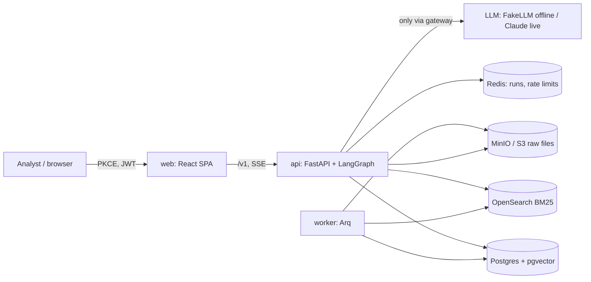
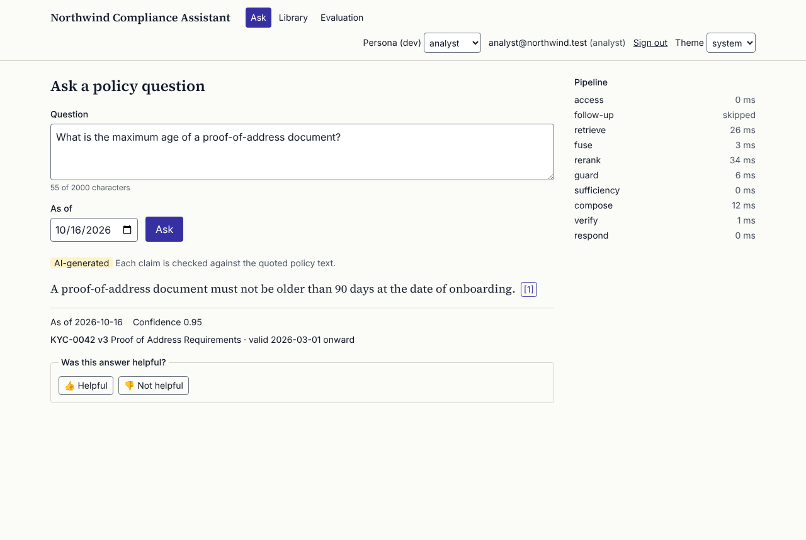

# compliance-rag

Compliance assistant for the fictional payments company "Northwind Payments": it answers policy questions
with verified, version-valid citations, enforces per-document permissions inside every search, and combines
keyword and vector search with reranking. The language model only composes answers; access control,
validity, retrieval, fusion, reranking, citation checks and abstention are deterministic code.

All data is synthetic (seeded generator, 400 policies, 1,199 versions). Runs fully offline by default.

## Problem

Analysts answer questions such as "can we onboard a customer whose proof of address is 95 days old?" by
keyword-searching about 1,200 versioned policy documents and then checking which version was in force.
Answers cite superseded versions, and Legal-only documents are either over-exposed or hidden. The system
has to answer with the version valid on a given date, quote it exactly, and never reveal a document the
reader may not see — not even that it exists.

## Result

Offline numbers are produced with the deterministic FakeLLM and say nothing about a live model's prose; they
measure the pipeline around it. Test split, 120 questions.

| What | Result | Source |
|---|---|---|
| ACL leakage (hard gate) | 0.000 over every retrieved, cited and listed document | [evals/REPORT.md](evals/REPORT.md) |
| Hallucinated citations (hard gate) | 0.000; citation precision 1.000 | [evals/REPORT.md](evals/REPORT.md) |
| Stale-version citations | 0.000 (gate < 0.01) | [evals/REPORT.md](evals/REPORT.md) |
| Retrieval quality | recall@10 0.915, MRR@10 0.932 | [evals/REPORT.md](evals/REPORT.md) |
| Answers and abstention | key-fact accuracy 0.886, abstention accuracy 0.933 | [evals/REPORT.md](evals/REPORT.md) |
| Reranking gain | recall@10 0.812 (BM25 alone) → 0.915 (hybrid + rerank) | [evals/REPORT.md](evals/REPORT.md#retrieval-ablation) |
| Prompt injection | 40 attacks, 0 failures; injected documents still answered 28 of 30 | [evals/reports/redteam.json](evals/reports/redteam.json) |
| Retrieval latency under load | p95 130.2 ms in the verification run of `e4da687`, worst recorded run 224.1 ms (budget < 300) | [evals/reports/bench.json](evals/reports/bench.json) |
| Time to first verified claim | p95 230.2 ms in the verification run of `e4da687`; recorded runs reach 395.7 ms, over the 300 ms budget | [evals/reports/bench.json](evals/reports/bench.json) |

Latency is from `make bench`: four concurrent clients against the local compose stack on a 4-vCPU machine. Time to first claim sits at its budget there and some recorded runs exceed it; every run is kept in [evals/reports/bench.json](evals/reports/bench.json) and the cause is in [docs/KNOWN_LIMITATIONS.md](docs/KNOWN_LIMITATIONS.md).

## Architecture



Each question runs a LangGraph graph: resolve the principal → (condense follow-up) → BM25 and vector legs in
parallel, both filtered by the reader's groups and the validity date inside the query → RRF fusion with a
counted ACL post-check and a Postgres re-check of index hits → feature reranker → context guard → abstain if
the evidence is weak → generate → verify every quote against the chunk text → stream only verified claims.
Details in [docs/architecture.md](docs/architecture.md); the API is in [docs/openapi.json](docs/openapi.json).

## Quick start

Requirements: Docker Engine 25 or later with Compose v2 (healthchecks use `start_interval`), `uv`, `pnpm`, GNU make. No API keys.

```bash
make bootstrap     # uv sync, pnpm install, .env from .env.example
make up            # the stack with healthchecks, migrations and the synthetic seed
open http://localhost:8600   # pick a persona in the header (analyst, legal, support, admin)
make demo          # the scripted end-to-end scenario
```

Then `make check-fast` (lint, types, unit tests), `make test` (with integration and contract tests),
`make e2e`, `make eval`, `make redteam`, `make bench`, or everything with `make verify`. Ports live in
8600–8699; see [docs/DEVELOPMENT.md](docs/DEVELOPMENT.md) and [docs/runbook.md](docs/runbook.md).



## Evaluation

300 synthetic questions with labels by construction (dev 180 / test 120): single-hop, multi-hop and numeric
questions, must-abstain questions, ACL probes asked by a persona that may not read the answer, and
version-sensitive questions with an `as_of` date. The reranker and the abstention threshold are tuned on dev
only. `make eval` gates every threshold of the spec and any regression against the committed baseline;
`make eval-ablation` compares five retrieval configurations; `make redteam` runs Promptfoo against the API.
Method and caveats: [docs/evaluation.md](docs/evaluation.md); full results: [evals/REPORT.md](evals/REPORT.md).

## Guardrails

- Permissions are part of every query (SQL, OpenSearch and Qdrant filters), checked again after fusion,
  and re-checked against Postgres for index copies; unauthorized resources answer 404 and restricted and
  unknown topics produce byte-identical abstentions.
- Documents are data: injected instructions are removed before generation, and canaries or unknown URLs in
  output are blocked. Only claims whose quotes match the cited chunk are shown.
- PII is redacted before any provider call; logs and traces carry ids and numbers, never question or
  document text; an append-only, hash-chained audit log records permission changes, uploads and purges.

Threat model and OWASP mapping: [docs/security.md](docs/security.md); design questions answered with code
references: [docs/design-faq.md](docs/design-faq.md).

## Decisions

Architecture decision records in [docs/adr/](docs/adr/) (pgvector by default, OpenSearch BM25, RRF fusion,
ACL pre-filtering, verified extractive citations, an offline LSA embedder, Arq, a Vite SPA, streaming only
verified claims); the running log of smaller decisions is [docs/DECISIONS.md](docs/DECISIONS.md).

## Limitations

Offline answers come from a deterministic extractive model; a live model has not been evaluated in this
repository (it needs a provider key). Everything else that is not done, or done with a caveat, is listed in
[docs/KNOWN_LIMITATIONS.md](docs/KNOWN_LIMITATIONS.md).

## How this was built

The system was built by a coding agent from the engineering specification in
[docs/specs/000-build-spec.md](docs/specs/000-build-spec.md), with test-first tasks, milestone reviews by
subagents, and every claim backed by a command or report. [docs/ai-development.md](docs/ai-development.md)
describes the workflow and the real mistakes found along the way; task-by-task evidence is in
[PROGRESS.md](PROGRESS.md) and verification in [docs/verification.md](docs/verification.md).

## License

MIT — see [LICENSE](LICENSE). Part of an AI engineering portfolio by
[@ROBERTG99](https://github.com/ROBERTG99).
