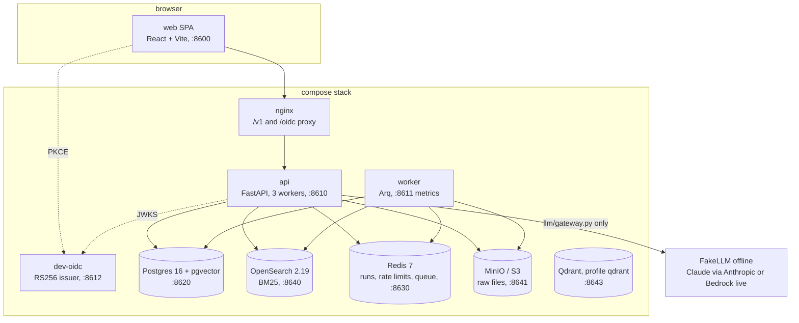
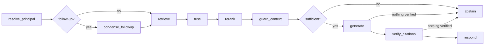

# Architecture

compliance-rag answers policy questions for the fictional tenant "Northwind Payments" with verified,
version-valid citations. The language model composes text; everything that decides *what* may be said —
permissions, validity at a date, retrieval, fusion, reranking, quote verification, abstention — is
deterministic code. This page follows one request through the system, then the write path, then the
operational pieces. Design questions with code references are answered in [design-faq.md](design-faq.md);
the decisions behind the shape are in [adr/](adr/).

## Services

| Component | Code | Role |
|---|---|---|
| API | `src/compliance_rag/api/` | Auth, ask (sync and SSE), documents, admin, feedback, evals; RFC 9457 errors; body and rate limits |
| Graph | `src/compliance_rag/graph/` | LangGraph nodes, claim stream parser, citation verifier, response builder |
| Retrieval | `src/compliance_rag/retrieval/` | Access filter, BM25 leg, vector legs (pgvector, Qdrant), RRF fusion, post-check, warm-up |
| Rerank | `src/compliance_rag/rerank/` | Logistic feature reranker fitted on dev; Cohere on Bedrock and a cross-encoder as options |
| Ingest | `src/compliance_rag/ingest/` | Loaders with magic-byte, page and zip-bomb guards; structure-aware chunker; pipeline; reindex |
| Guards | `src/compliance_rag/guard/` | Context guard (injection), output guard (canaries, unknown URLs), PII redaction |
| LLM | `src/compliance_rag/llm/` | The only module importing provider SDKs; routing, retries, cost, cassettes, FakeLLM |
| Worker | `src/compliance_rag/worker/` | `ingest_document`, `sync_acl`, `reindex_all`; crons for the S3 inbox, lag, ACL reconcile, retention |
| Observability | `src/compliance_rag/obs/` | OpenTelemetry spans, JSON logs with correlation and run ids, Prometheus metrics, step records |

## The read path: one question

1. **Principal.** The JWT (RS256, issuer, audience, expiry) maps to a role and groups; the role caps the
   groups so a token cannot grant itself more (`auth/`).
2. **Retrieve.** BM25 and vector legs run concurrently with a 250 ms budget each. Both receive an
   `AccessFilter` built from the principal and the `as_of` date, so the group overlap, `visible` and the
   validity window are part of the SQL `WHERE`, the OpenSearch `filter` and the Qdrant `Filter`. A failed or
   slow leg is reported as degraded; if both fail the request answers 503.
3. **Re-check and fuse.** Hits from index copies (OpenSearch, Qdrant) are re-checked against Postgres in one
   query; reciprocal rank fusion (k = 60) merges the legs and a post-check drops and counts anything outside
   the principal's groups or validity (`crag_acl_postcheck_violations_total`, which must stay 0).
4. **Rerank.** Five features (saturated BM25, cosine, best-sentence term overlap, entity match in the
   heading, freshness) and logistic weights fitted on the dev split. Per-chunk term sets and stored vectors
   are preloaded at start-up.
5. **Guard and decide.** Sentences that read as instructions to an assistant are removed from the context;
   below the abstention threshold the run abstains without calling the model. Abstentions for restricted and
   unknown topics are byte-identical.
6. **Generate and verify.** The model returns claims with quotes and chunk ids (JSON schema). Each claim is
   checked as it streams: the quote must occur in the cited chunk (whitespace and Unicode normalised), every
   number in the claim must occur in its quotes, and the output guard rejects canaries and unknown URLs. Only
   verified claims are emitted; the final answer is assembled from them.
7. **Stream.** Events (`run_started`, `node`, `retrieval`, `claim`, `claim_rejected`, `final`, `error`) go to
   a Redis stream per run (5-minute TTL) so a client can resume with `Last-Event-ID`; the answer, its steps,
   tokens, cost and latency are stored in `answers`.

## The write path: a new policy version

1. An admin uploads a file (or drops it with a sidecar into the S3 `inbox/`). The upload is size-capped
   before buffering, sniffed by magic bytes, content-addressed (same bytes → same job) and audited.
2. The worker parses and chunks it along article boundaries, embeds the chunks and writes them to Postgres,
   OpenSearch (and Qdrant when configured) as invisible.
3. Activation is one Postgres transaction under the document lock: the previous open version gets
   `valid_to`, the new chunks become visible with the document's current ACL, and an audit row is written;
   the indexes are then updated to match. A crash between stores is repaired by replaying the job, because
   every step is idempotent.
4. ACL changes commit with their audit row; index updates that fail stay pending and the
   `reconcile_acl` cron retries them every minute. Until then the Postgres re-check (step 3 above) keeps a
   revoked document out of answers.

## Operations

- **Observability.** One OpenTelemetry trace per request covers FastAPI, Postgres, Redis, OpenSearch and
  every graph node, with `gen_ai.*` attributes on model calls; exported spans drop exception messages and
  query strings. Logs are JSON with `correlation_id` and `run_id`, and text fields are redacted. Prometheus
  scrapes the API (all workers aggregated) and the worker; Grafana, Jaeger and alert rules come with the
  `observability` profile, Langfuse with the `langfuse` profile.
- **Retention.** A daily cron purges answers after 90 days (unless they still carry feedback), feedback after
  365, finished jobs after 30, and the graph checkpoints of conversations with no answer left.
- **Security.** Threat model, OWASP mapping and scan results: [security.md](security.md).
- **Running it.** [runbook.md](runbook.md) covers start-up, reindexing, key rotation and job replay;
  [DEVELOPMENT.md](DEVELOPMENT.md) the local workflow.
